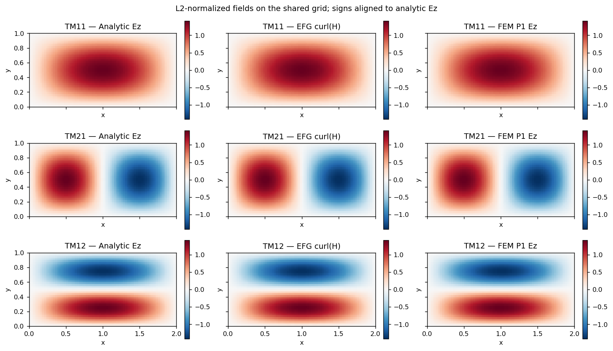
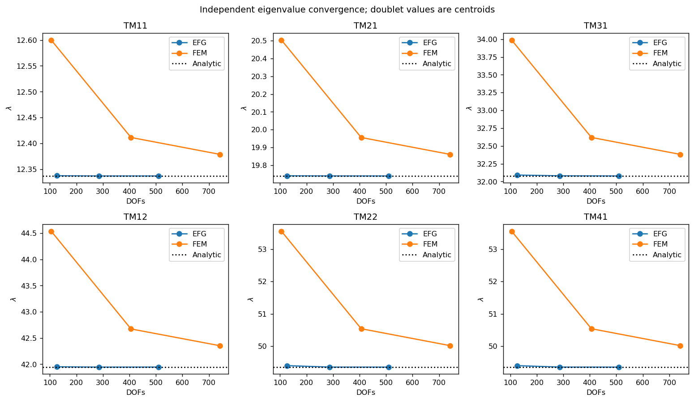
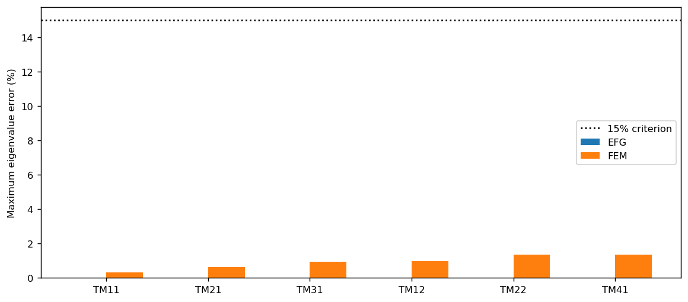
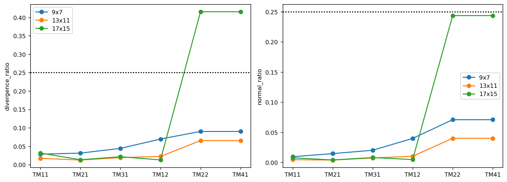
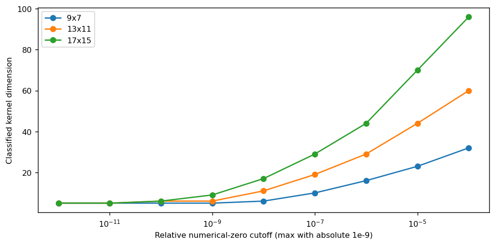

# M6a — Validação independente FEM × EFG, 21/10/2026

**Resultado: validação parcial dos candidatos selecionados.** TM11, TM21, TM31 e
TM12 passam nos critérios espectrais, espaciais e físicos usados nesta campanha.
O subespaço degenerado TM22/TM41 da nuvem EFG 17×15 **reprova por divergência**,
mesmo com bom autovalor e boa correlação espacial. Essa falha foi mantida nas
tabelas e figuras. A concordância entre Eigen e LAPACK verifica a solução dos
sistemas matriciais; ela não remove os modos espúrios da discretização EFG.

## Proveniência, geometria e execução

- EFG: `/home/sperotto/al-maleh-2009-vector-efg-waveguides`, remoto
  `Lucas-Sperotto/al-maleh-2009-vector-efg-waveguides`, main inicial atualizada
  `33fbf75acab8b7244052eb304d74396dda2fd881`, worktree inicialmente limpo.
- Código executado com exportação e validação:
  `dc1d98b53753ecf00573117d954c0a837dab9d49`, branch
  `feat/m6a-independent-fem-validation`. A implementação de exportação está
  no commit anterior `f2673c8`. Não houve mudança na montagem ou no Eigen solver.
- FEM: `/home/sperotto/fem-eigen-em-2d3d-whitney`, remoto
  `Lucas-Sperotto/fem-eigen-em-2d3d-whitney`, main
  `4c56a526b1a308edd2e17e3beec306f76dd5dce5`. Seus arquivos de saída locais
  preexistentes foram preservados. Nenhuma alteração de código ou commit FEM.
- Comando integral executado: `JOBS=2 bash scripts/run_independent_validation.sh`.
  Ele executou primeiro toda a suíte CTest e depois a campanha pública
  `JOBS=2 PROFILE=local bash scripts/run_local_reference.sh`, com destino novo.
  O FEM foi compilado separadamente e executado com
  `helm10_rect --ar-m 2.0 --nx NX --ny NY --nmodos 12 --backend closed-form`
  nos três refinamentos. Os comandos e logs estão nesta pasta.

As coordenadas EFG 0≤x≤2, 0≤y≤1 foram interpretadas na mesma unidade de
comprimento do FEM: 1 m. Assim, a=2 m, b=1 m, λ=kc² em m⁻². Materiais
uniformes, εr=μr=1. Não foi aplicado ajuste geométrico ou espectral.
A referência é λmn=π²(m²/4+n²).

| Família/caso | Nós | Células ou triângulos | DOFs = autovetores | Dimensão K/M ou S/T |
|---|---:|---:|---:|---:|
| EFG 9×7 | 63 | 8×6 células de integração | 126 | 126×126 |
| EFG 13×11 | 143 | 12×10 células de integração | 286 | 286×286 |
| EFG 17×15 | 255 | 16×14 células de integração | 510 | 510×510 |
| FEM coarse 16×8 | 153 | 256 triângulos | 105 | 105×105 |
| FEM medium 30×15 | 496 | 900 triângulos | 406 | 406×406 |
| FEM fine 40×20 | 861 | 1600 triângulos | 741 | 741×741 |

EFG: MLS linear, Wendland C2, suporte 3,3 vezes o maior espaçamento, quadratura
Gauss 3×3 por célula. FEM: elementos triangulares P1 e matrizes elementares
fechadas; somente TM Dirichlet entra na comparação. O executável FEM também
resolve TE, mas a instrumentação registra qual chamada corresponde a cada
família. O retorno LAPACK foi `info=0` em todas as chamadas.

A [auditoria dos solucionadores](../SOLVER_AUDIT.md) documenta matrizes,
simetria, positividade da massa, Cholesky, redução simétrica, normalização,
filtros nulos, versões, exportações existentes e a prova de captura transparente.
O registro [repository_audit.json](repository_audit.json) preserva remotos,
branches, HEADs, worktrees, caminhos reais e as condições do ambiente.

## Correspondência por campo e critérios

O EFG exporta curl(H)=∂Hy/∂x−∂Hx/∂y por avaliação MLS em 3200 centros de células
(grade comum 80×40). O FEM reconstrói Ez por coordenadas baricêntricas nos
triângulos da própria malha, com Ez=0 nos nós eliminados. Não se comparam
coeficientes entre as bases. Campos são normalizados em L2 físico ponderado;
o sinal de cada modo simples é ajustado pela correlação. O fator físico que
relaciona curl(H) a Ez não interfere na comparação de formas normalizadas.

A atribuição dos quatro modos simples maximiza globalmente as sobreposições
com as funções analíticas, impedindo reutilização de uma mesma coluna. A janela
espectral de 50% restringe apenas a busca exploratória. Para TM22/TM41 a seleção
é conjunta: escolhe o espaço de dimensão dois que maximiza a menor correlação
principal com o espaço analítico degenerado. A matriz de projeção é ortonormalizada
na norma física. Não são atribuídos nomes individuais às colunas desse par.

Mantiveram-se os critérios M4: erro relativo de λ≤0,15; sobreposição≥0,75;
razão de divergência≤0,25; indicador normal≤0,25; resíduo≤1e-7. O estado cruzado
também exige correlação espacial FEM×EFG≥0,75. Esses limiares definem candidatos
sustentados pelo experimento, sem certificar a formulação em outros problemas.
As tolerâncias algébricas adicionais e os limiares de núcleo estão nos JSON/CSVs.

## Autovalores nos maiores refinamentos

A tabela apresenta λ, e não kc. Para TM22 e TM41 ambos os nomes referem-se ao
mesmo par: o valor tabulado é o centroide das duas raízes; os erros do par são
o pior erro entre as duas raízes. `comparison.csv` conserva as seis referências,
limites mínimo/máximo, índices, resíduos e classificação.

| Modo | λ analítico | λ EFG | λ FEM | Erro EFG (%) | Erro FEM (%) | Dif. EFG×FEM (%) |
|---|---:|---:|---:|---:|---:|---:|
| TM11 | 12.337005501 | 12.337042476 | 12.378893335 | 0.000300 | 0.339530 | 0.339230 |
| TM21 | 19.739208802 | 19.739566674 | 19.861052948 | 0.001813 | 0.617270 | 0.615457 |
| TM31 | 32.076214304 | 32.078303537 | 32.381895944 | 0.006513 | 0.952985 | 0.946472 |
| TM12 | 41.945818705 | 41.946201091 | 42.354189955 | 0.000912 | 0.973568 | 0.972657 |
| TM22 | 49.348022005 | 49.353077806 | 50.018141049 | 0.019253 | 1.361573 | 1.347700 |
| TM41 | 49.348022005 | 49.353077806 | 50.018141049 | 0.019253 | 1.361573 | 1.347700 |

O intervalo do par EFG é [49,34863245017492; 49,35752316232138]; no FEM é
[50,0163508983609; 50,01993120032238]. A diferença cruzada usa os centroides,
dividida por λ analítico. A degenerescência exata é 5π², mas cada discretização
introduz uma pequena separação. O FEM P1 converge pelo lado superior nestas
rodadas; o EFG não possui, nesta implementação, uma garantia variacional
análoga para todos os candidatos.

## Campos, resíduos e indicadores físicos

O resíduo abaixo usa a mesma escala nos dois métodos:
`||Kv−λMv||₂ / ((||K||F+|λ|||M||F)||v||₂)`.
O diagnóstico nativo preparado do FEM também guarda o resíduo de ação das
matrizes, com outro denominador; veja a auditoria para evitar confundi-los.

| Modo/espaço | Correlação FEM×EFG | Erro L2 (%) | Divergência EFG | Normal EFG | Resíduo EFG | Resíduo FEM | Situação |
|---|---:|---:|---:|---:|---:|---:|---|
| TM11 | 0.999989939 | 0.448575 | 0.031352 | 0.007831 | 1.568e-14 | 3.265e-16 | candidato sustentado |
| TM21 | 0.999981249 | 0.612392 | 0.013238 | 0.004166 | 1.016e-14 | 3.301e-16 | candidato sustentado |
| TM31 | 0.999922774 | 1.242789 | 0.021471 | 0.008187 | 6.517e-15 | 4.635e-16 | candidato sustentado |
| TM12 | 0.999974343 | 0.716343 | 0.012726 | 0.004871 | 1.284e-14 | 3.248e-16 | candidato sustentado |
| TM22/TM41 (2D) | 0.991470652 | 13.060894 | 0.415285 | 0.243586 | 8.756e-15 | 3.844e-16 | **reprovado: divergência** |

Para modos simples o erro L2 é √(2−2|correlação|), após normalização e ajuste
de sinal. Para o par ele representa o pior desajuste de uma direção principal,
√(2−2σmin), e não erro de um autovetor individual rotulado TM22 ou TM41.
O ângulo máximo FEM×EFG do par é 7,48867°. As métricas espaciais do subespaço
são invariantes a rotações de base. Os indicadores físicos tabulados do par
são o máximo entre suas duas **colunas exportadas**; não representam um máximo
invariante sobre todas as combinações do espaço.

No par EFG fino, a coluna 192 tem divergência 0,007521 e indicador normal
0,002981; a coluna 193 tem divergência 0,415285 e normal 0,243586. Portanto,
o conjunto não passa no limite de divergência, mesmo com resíduo algébrico
muito pequeno. Não se selecionou apenas a coluna favorável para declarar
validado o par degenerado. O FEM tem traço Ez exatamente nulo no contorno
por eliminação dos nós de Dirichlet; o EFG conserva o contorno natural e
mede, sem impor fortemente, o fluxo normal e a divergência.

## Convergência e falha não monotônica do par

| Família/caso | λ TM11 | Erro TM11 (%) | λ TM21 | Erro TM21 (%) |
|---|---:|---:|---:|---:|
| EFG 9x7 | 12.337489662 | 0.003924 | 19.740473802 | 0.006409 |
| EFG 13x11 | 12.337044309 | 0.000315 | 19.739792966 | 0.002959 |
| EFG 17x15 | 12.337042476 | 0.000300 | 19.739566674 | 0.001813 |
| FEM coarse | 12.599869297 | 2.130694 | 20.503496158 | 3.871925 |
| FEM medium | 12.411517568 | 0.603972 | 19.955935832 | 1.097952 |
| FEM fine | 12.378893335 | 0.339530 | 19.861052948 | 0.617270 |

Os erros FEM dos seis alvos diminuem nos três refinamentos independentes.
No EFG, os erros espectrais melhoram nesta sequência, mas os indicadores de
campo não são todos monotônicos. O caso mais evidente é o par degenerado:

| Nuvem EFG | Pior erro λ do par (%) | Menor correlação analítica | Ângulo máximo (°) | Maior divergência por coluna | Maior normal por coluna |
|---|---:|---:|---:|---:|---:|
| 9x7 | 0.185134 | 0.998156944 | 3.479154 | 0.090052 | 0.070965 |
| 13x11 | 0.025380 | 0.999671695 | 1.468210 | 0.065215 | 0.040078 |
| 17x15 | 0.019253 | 0.991684663 | 7.393992 | 0.415285 | 0.243586 |

A piora física fina permanece visível mesmo quando o erro do autovalor cai.
Não se comprovou a causa; mistura com candidatos irrotacionais e sensibilidade
a condicionamento/suporte são hipóteses, sem intervenção nesta campanha.

## Verificação independente Eigen × LAPACK nas mesmas matrizes EFG

As matrizes persistidas são convertidas para exatamente a mesma transformação
usada pelo Eigen: A=(K+Kᵀ)/2 e B=(M+Mᵀ)/2. `LAPACKE_dsygv`, chamado via ctypes,
resolve esses sistemas completos novamente. Nenhum solver foi substituído.
A comparação usa tolerância absoluta `200*n*eps*max(1,max|λ|)` mais termo
relativo `1e-9*max(|λEigen|,|λLAPACK|)`. É um critério observado de concordância,
sem pretensão de ser um teorema de erro progressivo condicionado por M.
Valores perto de zero exigem comparação absoluta. O núcleo inteiro e os
clusters positivos são comparados em produto interno de massa; sinais e
rotações de autovetores degenerados não são tratados como falhas.

| Caso | Condição(M) EFG | Max Δλ absoluto | Max resíduo LAPACK | Menor correlação entre subespaços em M |
|---|---:|---:|---:|---:|
| 9x7 | 72373.617 | 7.574e-11 | 9.502e-16 | 1.000000000000 |
| 13x11 | 285083.856 | 9.647e-10 | 1.034e-15 | 0.999999999999 |
| 17x15 | 443914.097 | 1.029e-08 | 1.285e-15 | 0.999999999995 |

Os 922 autovalores e 905 grupos/subespaços passaram. A maior diferença foi
1,029e-8 em todo o espectro fino, abaixo do limite absoluto de 7,436e-8 desse
caso; a tolerância relativa contribui adicionalmente. Esse resultado afasta
uma divergência material entre os dois solvers como explicação para a falha
física encontrada, sem provar estabilidade da formulação para refinamentos maiores.

## Núcleo, candidatos espúrios e modos não investigados

Todos os valores e colunas foram exportados, inclusive pequenos λ negativos
de arredondamento. As três nuvens retêm respectivamente 2, 3 e 1 valores
não positivos; nenhum é materialmente negativo segundo o critério configurado.

| EFG | Corte padrão | Núcleo numérico | Positivos abaixo de λ TM11 | Positivos fora dos seis alvos |
|---|---:|---:|---:|---:|
| 9×7 | 6,327235e-7 | 5 | 49 | 115 |
| 13×11 | 1,713744e-6 | 6 | 94 | 274 |
| 17×15 | 3,283252e-6 | 9 | 144 | 495 |

Os 49/94/144 candidatos positivos abaixo do primeiro autovalor TM analítico,
associados a grandes divergências e fluxos normais, são evidência de
contaminação espúria ou núcleo deslocado no espectro vetorial sem restrições.
Por exemplo, a coluna fina 152 tem λ=12,2204330691, divergência=6,61617,
normal=2,51981 e resíduo≈2,06e-16. Proximidade de TM11 e precisão algébrica
não sustentam sua interpretação como TM físico.

As contagens fora dos seis alvos incluem modos superiores possivelmente
legítimos e não foram classificadas integralmente como espúrias. Esta campanha
não faz identificação física do espectro completo.

A varredura `zero_relative=1e-12..1e-4`, mantendo `zero_absolute=1e-9`, muda as
contagens do núcleo de 5 a 32, 5 a 60 e 5 a 96. Ela reclassifica os mesmos
autovalores salvos, sem modificar as soluções ou executar uma filtragem.
O aumento 5→6→9 no corte padrão não mede a dimensão exata do núcleo funcional.

## Persistência, integridade e testes

Foram preservados **2174 autovetores completos**, além de todos os autovalores
e de seis pares de matrizes. A normalização original em massa foi conservada.
As matrizes/autovetores são Matrix Market com gzip e 17 algarismos significativos.
Os arquivos EFG são `efg/{9x7,13x11,17x15}/eigenvectors.mtx.gz`; os FEM são
`fem/{coarse,medium,fine}/eigenvectors.mtx.gz`. Cada pasta inclui mapa de DOFs,
metadados e diagnósticos; as FEM incluem conectividade e campos reconstruídos.
Consulte o [guia dos formatos e da reprodução](../README.md).

Os dados ocupam aproximadamente 45 MB; o maior arquivo é o curl completo
EFG fino, com cerca de 13 MB. Nenhum binário executável ou biblioteca foi
versionado. Os resultados nativos originais adicionais são recuperáveis em
`/tmp/m6a-fem.CsJ2cS`, mas todos os arquivos necessários à verificação publicada
estão neste repositório. Os primeiros runs exploratórios estão em `/tmp/m6a-fem`.
O `manifest.json` contém caminhos relativos, tamanhos, SHA-256, fontes e parâmetros.

- Suíte inicial, antes das alterações: **7/7 CTests** aprovados.
- Suíte antes da campanha: **10/10 CTests** aprovados, incluindo 14 testes
  Python de álgebra, geometria, atribuição modal, degenerescência, leitura e
  adulteração de tabelas, mais 1 teste Python de integridade do manifesto.
- Empacotamento FEM: **42/42 verificações** aprovadas; controle coarse com e
  sem captura produziu os quatro arquivos espectrais nativos byte a byte iguais.
- Reabertura da campanha: seis exportações completas, três solves LAPACKE
  adicionais e **1896 linhas** de tabelas reconstruídas e verificadas.
- Suíte final, incluindo dados publicados e hashes: resultado no arquivo
  `final_ctest.log` e em `execution_summary.json`.
- Resultado físico fino: quatro modos simples sustentados e **um subespaço
  2D reprovado**, representado pelas duas referências TM22/TM41.

As matrizes de massa passaram Cholesky e espectro mínimo positivo. Não houve
falha de condicionamento, solve, timeout ou resultado não finito nas seis
rodadas desta campanha. O máximo erro M-ortogonal reaberto foi 4,340e-12 no
EFG fino e 1,066e-14 no FEM fino. Os resíduos completos reabertos foram no
máximo 2,102e-14 no EFG e 6,184e-16 no FEM, usando a escala Frobenius comum.
Valores positivos e nulos não foram removidos para melhorar os testes.

No ambiente original, o atalho `~/.local/bin/ctest` estava quebrado; foi usado
`/usr/bin/ctest`. Pacotes Python do usuário conflitavam com SciPy/Matplotlib
do sistema; `PYTHONNOUSERSITE=1` isolou o ambiente. Uma verificação intermediária
de hashes detectou corretamente um manifesto desatualizado após adicionar os
arquivos de auditoria; ele foi regenerado e o teste passou novamente. Não houve
alteração de dados numéricos em resposta a essa falha de inventário.

## Limites ainda não resolvidos

A falha de divergência do par fino não foi corrigida nem teve o limiar relaxado.
Não foram investigados todos os candidatos positivos nem demonstrada ausência
de modos espúrios. A grade física comum 80×40 não teve estudo próprio de
refinamento; suas integrais são aproximações de ponto médio. Os indicadores
EFG são calculados separadamente pela quadratura original. Não se estudaram
outras geometrias, escalas, materiais ou fontes de condicionamento maiores.
Os indicadores físicos por coluna do dupleto não certificam todas as suas
combinações lineares. A sensibilidade ao núcleo é uma análise de classificação,
sem mudar o espaço discreto. O verificador foi executado em Linux/LAPACKE;
nomes de bibliotecas e versões podem exigir adaptação em outros sistemas.
Nenhuma tabela específica da dissertação Al Maleh foi alegada como reproduzida.

Para reproduzir tabelas/figuras ou verificar os hashes sem o ambiente original,
use os comandos do [README da validação](../README.md). Os capítulos de teoria
e os resultados M4 publicados anteriormente permaneceram intactos.
